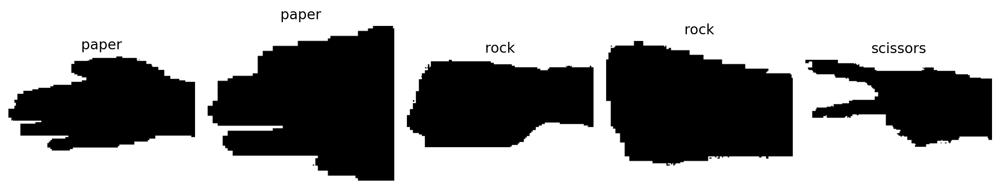
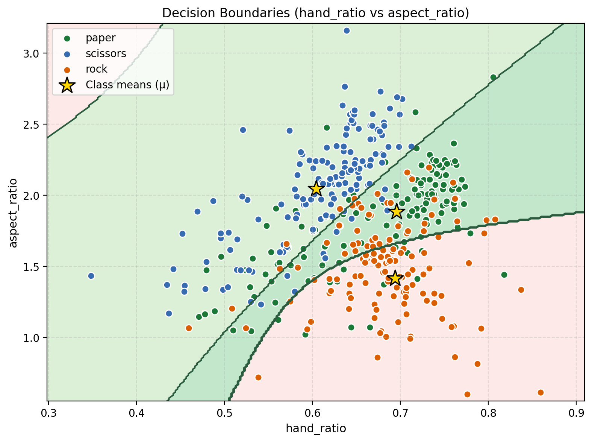
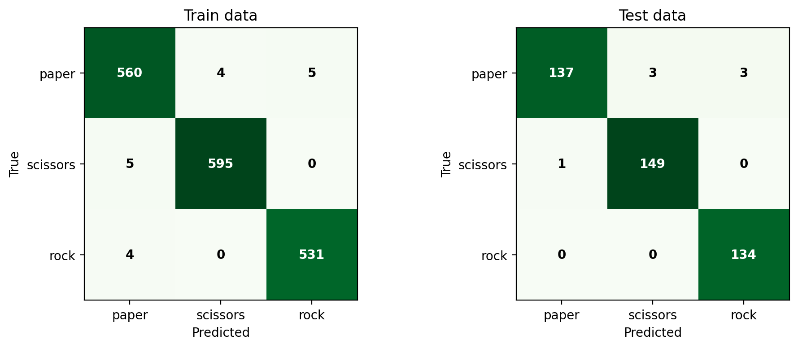
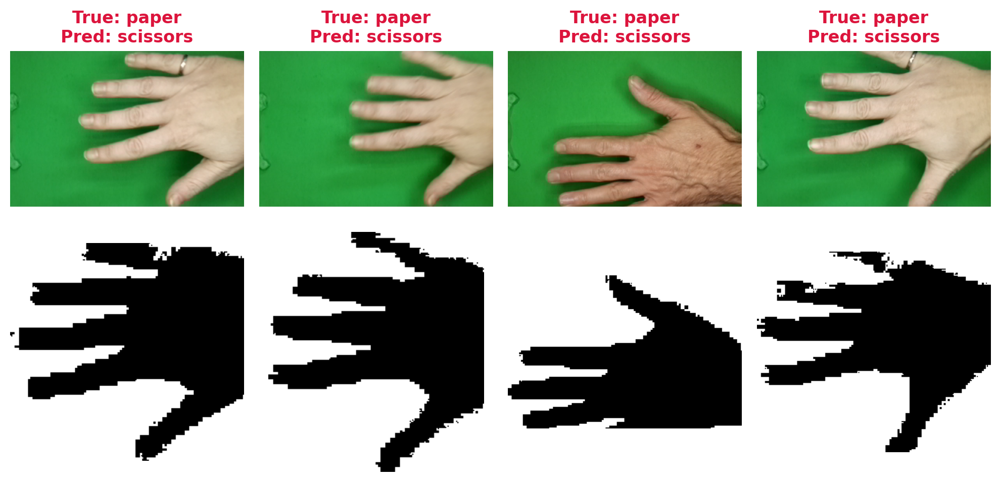

# Rock Paper Scissors Classification

A simple image classification project that recognizes hand gestures for rock, paper and scissors. The hand is separated from the background, a few numbers (features) are measured on it, and a Bayes classifier written in NumPy decides which gesture it is.

## How It Works

### 1. Preprocessing

| Step | What it does |
| :--- | :--- |
| Hand mask | Finds the hand using the difference between the red and green channel |
| Fill holes | Fills small gaps inside the hand |
| Crop | Cuts the image to the smallest box around the hand |

### 2. Features

6 features are measured on every cropped hand:

| Feature | Description |
| :--- | :--- |
| `hand_ratio` | How much of the cropped image is covered by the hand |
| `centre` | How much of the middle part of the image is covered by the hand |
| `left`, `right` | How much of the left and right edge strips is covered by the hand |
| `left_third` | How much of the left third of the image is covered by the hand |
| `aspect_ratio` | Width divided by height |

### 3. Classification

- The data is split 80% train and 20% test for each class
- A Bayes classifier with a separate Gaussian model for each gesture is used
- The code is written from scratch using only NumPy (no ready-made classifiers)

## Results

| Dataset | Accuracy |
| :--- | :---: |
| Train (80%) | 98.94% |
| Test (20%) | **98.36%** |

### Preprocessing

### Decision boundaries
Drawn for two features only (`hand_ratio` and `aspect_ratio`), so they only illustrate the idea and are not the boundaries of the full 6-feature classifier.

### Confusion matrices

### Misclassified examples

## Project Structure

| File / Folder | Description |
| :--- | :--- |
| `rock_paper_scissors.py` | Preprocessing, feature extraction and classifier |
| `requirements.txt` | Python libraries needed |
| `README.md` | This file |

## How To Run

1. Install the libraries: `pip install -r requirements.txt`
2. Put the dataset into a folder called `Rock Paper Scissors/`, with one subfolder per gesture (`rock`, `paper`, `scissors`)
3. Run: `python rock_paper_scissors.py`
